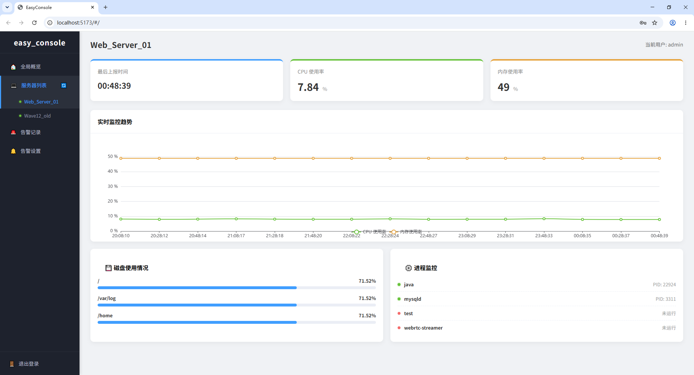

# easy_console

开源服务器监控与远程管控控制台 (Open-source server monitoring and remote management console)

easy_console 是一个轻量级的服务器监控 Agent，支持采集 CPU、内存、磁盘、进程等指标，并通过 MQTT 或 HTTP 协议上报。项目内置了所有第三方依赖库，支持一键 Docker 部署和源码离线编译。

## ✨ 核心特性

- **多协议支持**：同时支持 HTTP 和 MQTT 上报。
- **开箱即用**：第三方依赖（Paho MQTT、JSON、HTTPLib）全部内置（Vendored），无需联网下载外网库，彻底告别环境配置地狱。
- **多部署方式**：提供 Docker 一键部署（适合普通用户）与源码编译安装（适合开发者/定制）。
- **多平台支持**：完美兼容 Linux 环境。

## 🚀 快速开始

我们提供两种部署方式，请根据您的需求选择：

### 方式一：Docker 一键部署（推荐给普通用户）

无需配置任何 C++ 环境，只需确保服务器已安装 Docker。在项目根目录下执行：

```bash
chmod +x install_from_docker.sh
./install_from_docker.sh
```
(脚本会自动构建/拉取镜像、生成配置文件、并启动后台容器。运行完成后，可通过 docker logs -f easy_console 查看运行状态)


### 方式二：源码编译安装（推荐给开发者或内网环境）

如果你需要二次开发，或服务器没有 Docker，可使用此方式。项目已内置所有源码依赖，支持离线构建：

```bash
chmod +x install_from_source.sh
./install_from_source.sh
```
(脚本会自动编译 Paho 库并安装到系统，随后编译主项目。生成的二进制文件位于 build/easy_console)

⚙️ 配置文件说明
无论使用哪种方式，在首次启动前，你都需要准备配置文件：

复制根目录下的配置模板文件：

```bash
cp config.example.json config.json
```
编辑 config.json 填入你的信息：

```json
{   
    "decimal_places": 2,
    "sender_type": "mqtt",
    "server_url": "http://127.0.0.1:5567",                
    "mqtt_broker": "tcp://127.0.0.1:1883",
    "mqtt_username": "YOUR_USERNAME",
    "mqtt_password": "YOUR_PASSWORD",
    "mqtt_topic": "monitor/agent/metrics",
    "mqtt_client_prefix": "easy_console_",
    ...
}
```
(注：sender_type 可选 "mqtt" 或 "http")

修改配置后，重启服务生效：

Docker 方式：docker restart easy_console

源码方式：结束进程后重新运行 ./build/easy_console

## 📦 程序结构

```text
easy_console/
├── CMakeLists.txt          # CMake 构建配置文件
├── README.md               # 项目说明文档
├── config.example.json     # 配置示例文件模板
├── install_from_docker.sh  # Docker 一键部署脚本 (普通用户)
├── install_from_source.sh  # 源码一键编译脚本 (开发者)
├── install_service.sh      # systemd 服务安装脚本
├── uninstall_service.sh    # systemd 服务卸载脚本
├── LICENSE                 # 开源许可证 (AGPL-3.0)
├── include/                # 核心头文件
│   ├── models/
│   │   └── MetricData.h    # 数据结构定义
│   ├── config/
│   │   └── GlobalConfig.h  # 全局配置类
│   ├── collectors/
│   │   ├── ICollector.h    # 采集器基类接口
│   │   └── CollectorFactory.h # 工厂类
│   └── sender/
│       ├── ISender.h       # 上报器基类接口
│       └── HttpSender.h    # HTTP 上报器接口
├── src/                    # 核心源代码
│   ├── main.cpp            # 主线程调度
│   ├── collectors/
│   │   ├── LinuxCollector.cpp # Linux 平台实现
│   │   └── WindowsCollector.cpp # Windows 平台实现 (开发中)
│   └── sender/
│       ├── HttpSender.cpp
│       └── MqttSender.cpp
├── third_party/            # 第三方依赖库 (内置，无需单独下载)
│   ├── nlohmann/json.hpp   # JSON 解析库
│   ├── httplib.h           # HTTP 客户端库
│   ├── paho.mqtt.c/        # Paho MQTT C 源码
│   └── paho.mqtt.cpp/      # Paho MQTT C++ 源码
└── test/
    └── httpServer.py       # 测试用 HTTP 接收端
```

## ☁️ 云平台支持与商业服务

**本仓库仅开源客户端采集程序（Agent）及基础部署脚本。** 完整的云端多租户管理后台（Web 控制台）为闭源商业产品。

如果你不想自己搭建数据库和维护后端，可以直接使用我们提供的云端托管服务：

1. 访问 [EasyConsole 云平台](此处填入你的网址) 注册账号。
2. 在控制台获取您的专属 `Agent Token`。
3. 将 Token 写入客户端的 `config.json` 中，即可在网页上实时查看监控数据。

> **关于云平台使用**：目前云平台已上线，如需对接、开通高级权限或遇到问题，请联系项目负责人。

云平台截图：



## 📄 开源许可证
本项目采用 AGPL-3.0 许可证开源。
